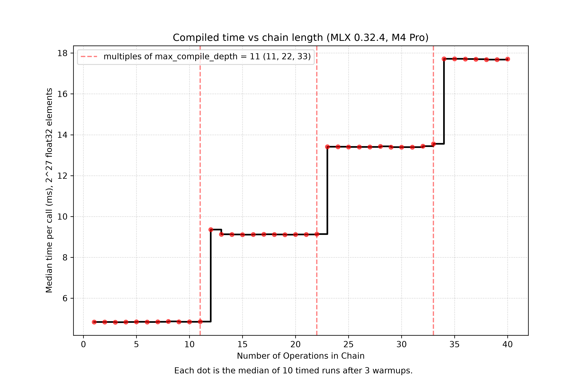
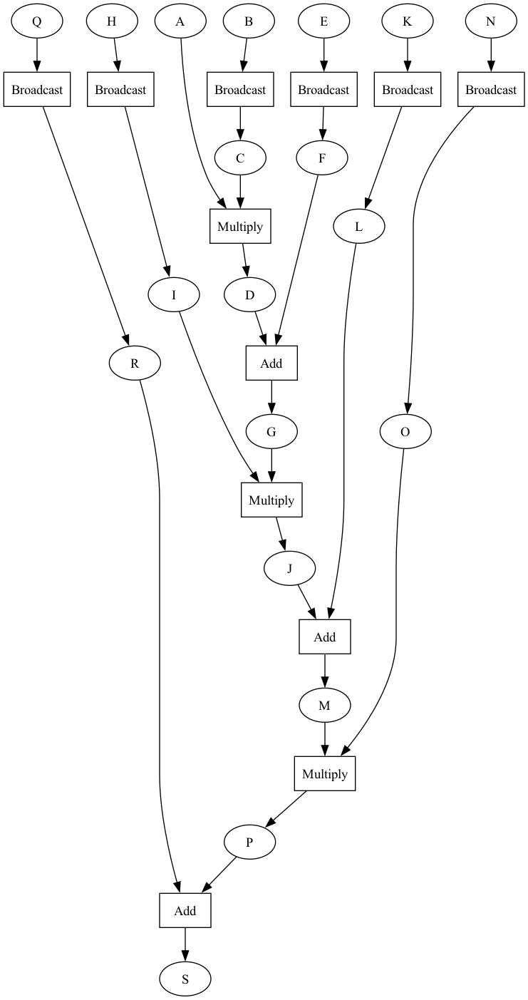

# What happens between a Python line and the GPU on Apple Silicon: measuring `mx.compile`

*All scripts, raw logs and CSVs: [github.com/Krishdeep13/mlx-m4-benchmarks](https://github.com/Krishdeep13/mlx-m4-benchmarks). MLX tag v0.32.4, commit `36969c094354086e15d2a327a9c50feb20b9cf11`.*

This post measures kernel fusion in MLX on one MacBook Pro. Every number comes from my own logs. Every source claim links to code or docs. Anything I did not measure is labeled as a hypothesis or listed under Limitations.

## 1. The problem: every op pays a trip through memory

A GPU does math fast, but it spends much of its time waiting on memory. Take this code:

```python
y = x * 2.0
y = y + 1.0
y = mx.sin(y)
```

Run op by op (eager), each line becomes its own GPU program, called a kernel. Each kernel reads its whole input from memory and writes its whole output back. Three ops mean three reads and three writes. Most of those trips only hand a temporary result to the next kernel.

The data does not go back to the CPU between ops. The CPU only encodes the work. The wasted trip is kernel to memory to kernel.

Fusion fixes this. The framework merges the chain into one kernel. That kernel reads `x` once, does all the steps in registers, and writes the result once. The math is the same, and the memory traffic is much smaller.

To merge ops, the framework must see the whole chain. It gets that from a **computation graph**: it runs your function once with placeholder arrays and records each op as a node. Then it can rewrite the graph before running it.

## 2. MLX and JAX

- **MLX** records a lazy graph by default. Nothing runs until `mx.eval`, or until something forces it, such as printing or `.item()`. `mx.compile` is a separate, optional step that traces a function and lets the compiler merge ops.
- **JAX** does the same job with `jax.jit`. It traces the function to a jaxpr and hands it to the XLA compiler, which does the optimization, including fusion. Docs: [jit](https://docs.jax.dev/en/latest/201/jit.html), [jaxpr](https://docs.jax.dev/en/latest/601/jaxpr.html), and [JAX, XLA and Pallas](https://maxtext.readthedocs.io/en/latest/reference/core_concepts/jax_xla_and_pallas.html).
- **Shared idea:** trace once, reuse the result while shapes and dtypes match, and retrace when they change. I measured this on the MLX side (section 7).
- **Difference:** JAX is functional and goes through XLA. MLX behaves more like NumPy with lazy evaluation, and has no XLA step.

I did not run JAX for this post. The JAX statements rest on the linked docs, and I have not measured JAX on Apple silicon.

## 3. My system

| Item | Value |
|---|---|
| Machine | MacBook Pro 16-inch (Nov 2024) |
| CPU | Apple M4 Pro, 14 cores (10 performance, 4 efficiency) |
| GPU | 20 cores, `applegpu_g16s` |
| Memory | 24 GB unified (25,769,803,776 B) |
| GPU working-set limit | 17,179,885,568 B (16 GiB). Max buffer 12,884,901,888 B. |
| Memory bandwidth | 273 GB/s, [Apple's stated figure for M4 Pro](https://www.apple.com/in/newsroom/2024/10/apple-introduces-m4-pro-and-m4-max/). I did not measure it. |
| OS | macOS 15.5 (24F74) |
| Python | 3.15.2 (Homebrew, no venv) |
| Packages | mlx 0.32.4, mlx-metal 0.32.4, numpy 2.5.4 |
| Tools | Xcode 16.4 |
| Power | AC power confirmed at the start of each run. Low Power Mode off. |

I ran everything on AC power, with other GPU apps closed and about 20 s of idle between experiments. My first runs were on battery, so I discarded them and reran everything. Each experiment ran in two separate sessions, and the results matched within a few percent unless noted.

## 4. Unified memory: why fusion still helps

On a discrete GPU, data crosses a PCIe link between CPU and GPU memory. Apple silicon has no such copy, because the CPU and GPU share one memory pool. Fusion still helps, because **unified memory removes the copy, not the memory traffic**.

- One eager elementwise op on 2^27 float32 elements (512 MiB) cost about 4.3 ms. It reads and writes 1 GiB, which works out to about 250 GB/s. That is close to the 273 GB/s spec figure, so the op is limited by memory, not by math. (The 250 GB/s is my arithmetic, not a hardware measurement.)
- A fused chain of up to 11 ops cost about 4.8 ms, roughly one pass over memory.
- The GPU has far more compute than bandwidth. I measured 6.66 TFLOPS (fp32) and 7.5 TFLOPS (fp16) on large matmuls. An elementwise op does about one operation per 8 bytes moved, so it uses a small part of that. Extra math inside a fused kernel is cheap.

I tested only arrays far larger than the CPU caches (16 MiB L2 per performance cluster). I have no figure for GPU or system-level cache size, and arrays that fit in cache would probably gain less.

## 5. How I measured

- **The timer stops only after `mx.eval`.** Without it I timed graph building: under 1 µs, not compute.
- **Warmup 5-10 runs, then 15-25 timed runs.** I report the median and the p10-p90 range, never the mean alone.
- **Sync cost, large ops** (4096x4096 matmul plus add): one eval at the end took 21.49 ms. Eval after each op took 21.73 ms. That is about 0.23-0.26 ms extra, about 1%.
- **Sync cost, tiny ops** (20 elementwise ops on 64x64): 0.20 ms with one eval, 2.11 ms with eval after each. That is about 96 µs per extra eval. The per-call floor was about 0.12-0.17 ms.
- **"Effective GB/s"** means the minimum bytes (one read plus one write) divided by time. It is not hardware traffic. Eager really moves more bytes.

## 6. Results

### 6.1 Fusion works, and the output is identical

A 5-op elementwise chain on 2^27 float32 elements:

| Variant | Median | p10-p90 | Effective GB/s |
|---|---|---|---|
| Eager | 22.33 ms | 22.28-22.37 | 48.1 |
| `mx.compile` | 4.80 ms | 4.78-4.83 | 223.7 |

That is **4.65x**, with a max absolute difference of 0.0 (bit-identical). Both sessions agreed (22.30 / 4.80 ms and 22.33 / 4.80 ms).

### 6.2 MLX does not fuse by default

If MLX fused on its own, eager time would flatten as the chain grew. It does not. Eager time grows by about 4.3 ms per op, from 2 ops up to 256:

| Steps (K, 2 ops each) | Eager | Compiled | Speedup |
|---|---|---|---|
| 1 | 9.13 ms | 4.80 ms | 1.90x |
| 4 | 34.78 ms | 4.81 ms | 7.24x |
| 16 | 137.42 ms | 13.36 ms | 10.29x |
| 128 | 1131.97 ms | 104.10 ms | 10.87x |

The speedup levels off at about 10.6-10.9x for K of 32 and above. This shows no automatic fusion in my measurements. I did not read the source to prove that eager never fuses.

### 6.3 The staircase and the 11-op limit

I compiled a chain of 1 to 40 ops. Compiled time did not grow smoothly. It grew in steps:

| Ops | Compiled time |
|---|---|
| 1-11 | 4.83-4.87 ms |
| 12-22 | 9.11-9.36 ms |
| 23-33 | 13.39-13.56 ms |
| 34-40 | 17.68-17.71 ms |



*Figure 1. Compiled time vs chain length (MLX 0.32.4, M4 Pro, 2^27 float32 elements). Each dot is the median of 10 timed runs after 3 warmups. Dashed lines mark multiples of `max_compile_depth = 11`.*

Each step is about 4.5 ms, close to one more pass over memory. The jumps fall after 11, 22 and 33 ops. In MLX's source, [`mlx/compile.cpp`](https://github.com/ml-explore/mlx/blob/v0.32.4/mlx/compile.cpp) line 25 reads `constexpr int max_compile_depth = 11;`, and line 857 checks `depth >= max_compile_depth`. Line 26 sets `max_compile_arrays = 24`, checked at lines 884 and 900. My chain never touched the second limit.

This is **consistent with the limit, not proof**. I did not count kernels, so I did not show that each step is one extra kernel.

### 6.4 Not every op gains (4096x4096, medians)

| Case | fp32 | fp16 |
|---|---|---|
| Elementwise chain | 3.8-4.1x | 2.3x |
| `where` | 4.6-4.9x | 4.6-4.7x |
| Layernorm | 1.31-1.32x | 1.26-1.30x |
| Softmax | 0.97-1.00x | 0.99-1.01x |
| Matmul + gelu | 1.00x | 1.00x |

All outputs were bit-identical. Fusion pays off when many cheap ops chain together. It gained nothing when one heavy op dominated (matmul) or when the work was already a single op (softmax). That explanation is my hypothesis, and I did not test it.

### 6.5 Correctness

For 5 functions, 3 dtypes (fp32, fp16, bf16) and 6 shapes, eager and compiled matched in all 90 cases (max difference 0.0). Edge values (0, -0, ±1e30, ±inf, NaN) matched for 3 functions, and gradients matched for 2 functions. This holds for those functions only.

### 6.6 What the graph looks like



*Figure 2. The lazy graph MLX recorded for a 6-op chain on 1,024 float32 elements (`mx.export_to_dot`, MLX 0.32.4), before `mx.compile`. Each arithmetic op is its own node, and each Python scalar becomes a broadcast array. This shows what MLX records, not which kernels run.*

The picture shows 6 arithmetic nodes and 6 broadcast nodes. That is the graph the compiler has to work with. It does not show fusion by itself. The timings and the staircase carry that claim.

## 7. Where `mx.compile` breaks, and what to avoid

All results are from two sessions on MLX 0.32.4.

| Pitfall | What I saw | What to do |
|---|---|---|
| A global changes after the first call | Compiled kept the old value (2.0). Eager used the new one (3.0). Same for a Python float and an `mx.array` global. | Pass values as arguments. |
| Side effects | The Python body ran **1 time in 5 calls**. | Keep `print` and counters out of compiled code. |
| Random numbers | Two compiled calls gave identical output. With RNG state passed, they differed. | Pass state via `inputs=` and `outputs=`. |
| `.item()` inside compile | `ValueError: [eval] Attempting to eval an array during function transformations like compile or vmap is not allowed.` | Keep values as arrays. Branch with `mx.where`. |
| New shape or dtype | The body ran again (trace counter 1 to 2 for a shape, 2 to 3 for fp16). Returning to a seen shape did not retrace. | Keep shapes and dtypes fixed. |
| Python scalar arguments | Body ran 2 times for k = 2, 2, 3. With `mx.array(k)` it ran **1 time** for k = 2, 3, 4. | Pass changing scalars as `mx.array`. |
| `shapeless=True` | The body ran once for two different shapes. | Use only if the function does not depend on shape. |
| Compiling inside a loop | 20 traces in 20 iterations, against 0 when compiled once. | Compile once, outside the loop. |
| Changing shapes every call | 20 traces in 20 calls, against 0 for a fixed shape. | Pad or bucket shapes. |
| Too many evals | About 96 µs per extra eval on tiny ops. | Eval once per step. |

**The per-call cost of retracing was small in my loop test.** For a 10-op function on 2^20 elements, compiling every iteration cost 0.254 ms against 0.225 ms for compiling once. Varying the shape cost 0.195 ms against 0.211 ms for a fixed shape, which is within noise. I did not measure a large tracing cost. The expensive call was the first compiled call, and it varied widely: **about 7 ms to 273 ms across runs, against 4.8 ms steady.** I do not quote a compile time, and I did not find the cause of the variation.

## 8. The first call after idle

On a 4096x4096 fp32 matmul, steady state was 20.62-20.65 ms. After a pause, the first call was slow in all 40 idle gaps I tested (4 pause lengths, 5 repeats, 2 sessions):

| Idle before the call | First call (range across both sessions) | Second call |
|---|---|---|
| 0.1-1 s | about 29-36 ms | 20.7-23.9 ms |
| 5-10 s | about 42-64 ms | 21.7-25.4 ms |

The penalty repeats, but its size changes by session, so I give ranges. It may be a power-state or clock effect, but I did not find the cause. The sleeps ran in ascending order, so slow drift is mixed in with pause length. This is why a single timed call, or one right after a pause, misleads.

## 9. Limitations

- **Kernel counts, registers and occupancy were not measured.** I tried a Metal GPU capture with `mx.metal.start_capture` and `MTL_CAPTURE_ENABLED=1`. The files for an eager run and a compiled run were the same size (17,851 bytes), so they held no usable data. I do not know why. Instruments attached to the right process, but I could not read kernel counts from it. So the staircase supports "one extra memory pass per step" without showing it directly.
- **How MLX merges ops is not explained here.** I read the limits in `compile.cpp`, not the merging code.
- **JAX was not run.** An earlier JAX-versus-NumPy figure had no log, so I dropped it.
- One machine, two sessions, MLX only.
- AC power was checked at the start of each run, not throughout.
- The correctness results do not generalize beyond those functions, dtypes and shapes.

## 10. Next post: registers, spills and backpropagation

*Everything in this section is a hypothesis. I did not measure it.*

Fusion keeps temporary values in registers. Each GPU thread has a limited number of registers. A long fused chain keeps many values alive at once, and past a point the compiler may spill values to slower memory, or run fewer threads at a time.

Training makes this harder, because the backward pass needs many values from the forward pass. For each value you can **store** it, which costs memory, or **recompute** it, which costs math. This trade-off is called rematerialization, or checkpointing. A reasonable rule is to store the values that are expensive to recompute and recompute the cheap ones.

The next post tests this with a hand-written kernel split into 1, 2 and 4 kernels, with real profiler data if I can get it.
